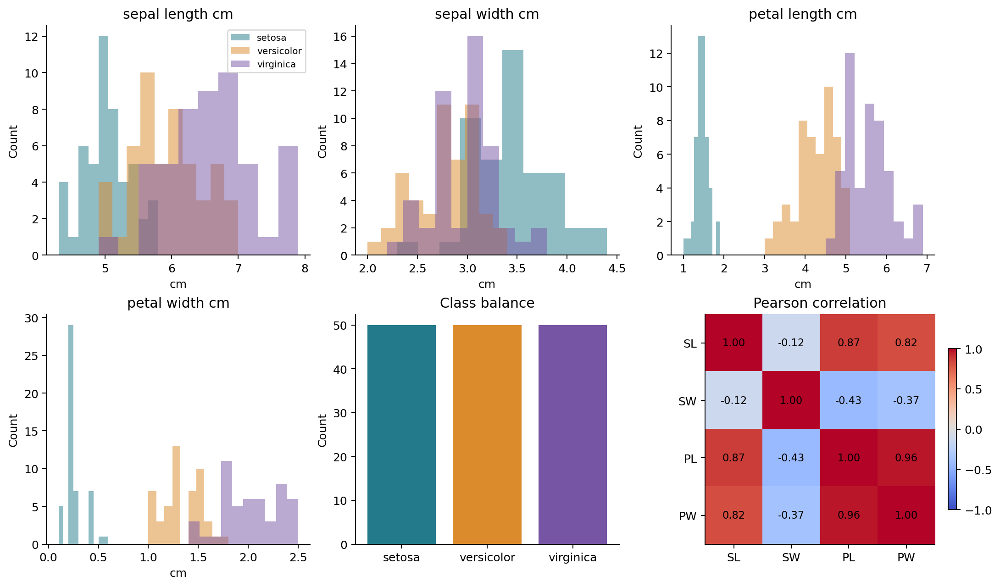
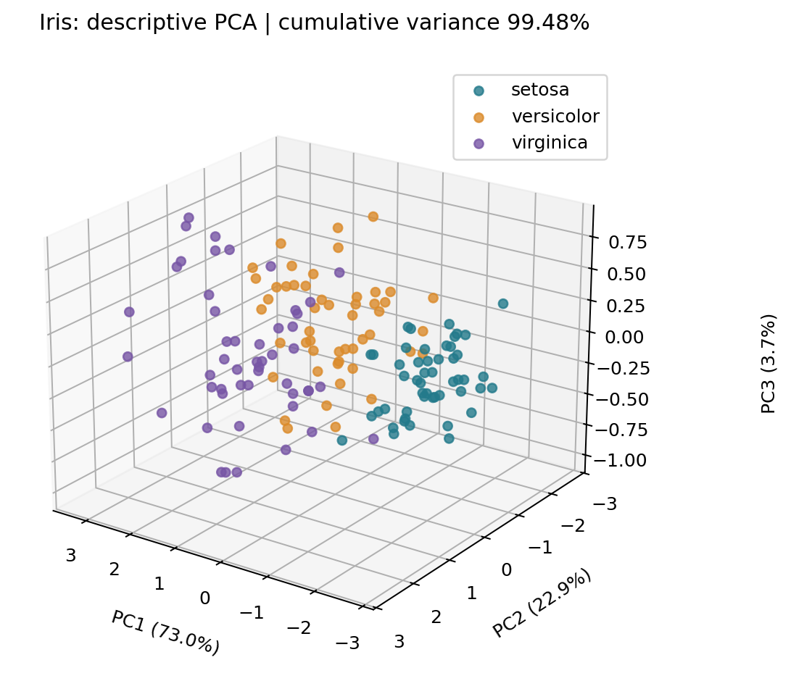
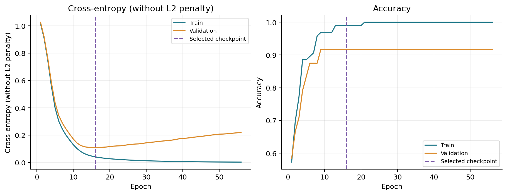
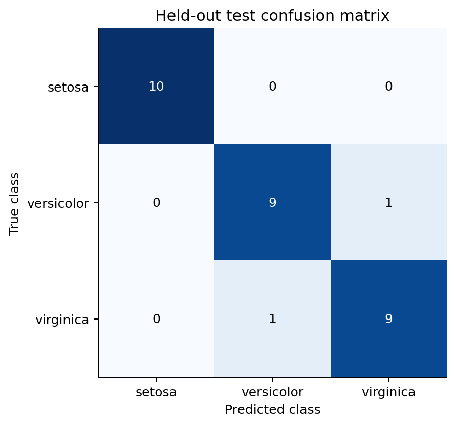
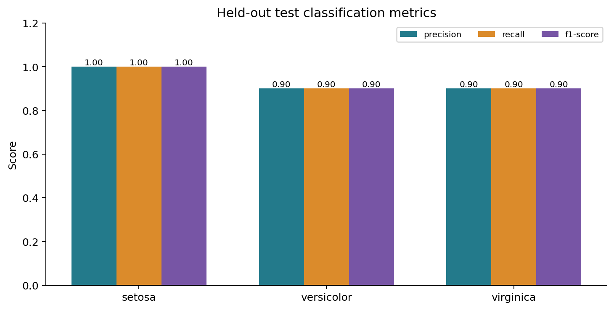

# Iris 花卉資料的特徵探索與
類神經網路分類實驗

課程小論文 | Issue #2 | 固定種子 42 | 可重現實驗

## 摘要

本研究使用 scikit-learn 內建 Iris 資料的 150 筆觀測，探討四項花卉形態特徵與品種分類的關係。以標準化後的主成分分析建立三維分布圖，前三個主成分累積解釋 99.48% 的變異。將資料分為訓練 96 筆、驗證 24 筆及測試 30 筆，使用 4-16-8-3 多層感知器分類。測試準確率為 93.33%，macro F1 為 0.9333。結果顯示此模型在本次固定切分具有辨識能力，但有限測試樣本與單次實驗不足以支持普遍性的最佳模型主張。

關鍵詞：Iris、主成分分析、類神經網路、分類、測試導向開發

## 一、研究動機與目的

本研究建立從資料保存、品質檢查、探索視覺化到分類評估的完整流程。研究問題為：四項形態測量能否區分三種鳶尾花？降維圖所呈現的重疊，與模型誤分類是否具有一致的描述性特徵？本研究不進行因果推論，亦不以提高測試準確率為目的反覆調整模型。

## 二、資料與欄位

| 欄位 | 意義與型態 |
| --- | --- |
| sample_id | 來源列編號（0 起算），整數，不作為特徵 |
| sepal_length_cm / sepal_width_cm | 花萼長度／寬度，浮點數，公分 |
| petal_length_cm / petal_width_cm | 花瓣長度／寬度，浮點數，公分 |
| target / species | 0=setosa、1=versicolor、2=virginica；整數標籤及文字名稱 |

資料來源為 sklearn.datasets.load_iris 的內建修正版，原始研究為 Fisher（1936）。各品種 50 筆；版本、取得時間與 CSV 的 SHA256 記錄於 data/metadata.json。[1][2]

# 三、資料品質與基本探索

資料共有 150 筆，所有欄位缺失值合計 0。排除樣本編號後，額外重複觀測有 1 筆；對應來源列為 [101, 142]。原始 CSV 保留全部資料，不將相同測量直接視為錯誤；資料切分時則把相同特徵向量放在同一集合，避免跨集合重複。

以各欄位 Q1-1.5×IQR 與 Q3+1.5×IQR 為界，花萼寬度標記 4 筆，其餘三項為零。這些標記僅用於描述性檢查，未有量測錯誤證據，因此保留；不據此制定模型的資料排除規則。

圖 1　四項特徵分布、品種筆數與 Pearson 相關係數。SL/SW 為花萼長／寬，PL/PW 為花瓣長／寬。

花瓣長與花瓣寬的分布在 setosa 與其他品種之間較易區分；versicolor 與 virginica 存在重疊。花瓣兩項測量呈現強正相關。相關係數及分布僅描述本資料集，不代表因果關係。完整描述統計、品種平均與相關矩陣保存於 results/。

# 四、PCA 三維特徵分布

PCA 前先對四項特徵進行零平均、單位標準差轉換，再用完整 SVD 求取三個主成分。本圖對全體資料進行描述性探索，未將 PCA 分數輸入分類模型；模型使用獨立的、僅以訓練集擬合的標準化器。[3]

圖 2　標準化特徵的 PCA 3D 散布圖，各顏色代表一個品種。

| 主成分 | 解釋變異比例 |
| --- | --- |
| PC1 | 72.9624% |
| PC2 | 22.8508% |
| PC3 | 3.6689% |
| 累積 | 99.4821% |

setosa 在投影中形成較獨立的群集，其餘兩類部分交疊。保留大部分變異不等於保證最佳分類能力，PCA 本身也未使用品種標籤；主成分軸的正負號不具有固有生物意義。分數及負荷量另存為 CSV，以供查核。

# 五、模型與訓練程序

先對相同特徵向量建立群組，再以種子 42 進行兩階段分層切分：20% 群組作測試集，其餘群組再取 20% 作驗證。實際筆數為 96／24／30，各類別分別為 32／8／10。標準化器只看訓練集；驗證集用於選擇 checkpoint，測試集不參與模型選擇。

| 設定 | 值 |
| --- | --- |
| 網路 | 4 個輸入 → 16 ReLU → 8 ReLU → 3 softmax |
| 訓練 | Adam；learning rate=0.01；batch size=16；L2 alpha=0.0001 |
| 目標 | 多類別交叉熵，訓練含 L2 懲罰；圖中為不含 L2 的交叉熵 |
| 選擇規則 | 最多 500 輪，驗證 loss 連續 40 輪未改善即停止；保留最低 loss 權重 |

實際訓練 56 輪，選取第 16 輪；該輪訓練 accuracy=98.96%、驗證 accuracy=91.67%，驗證 loss=0.1100。模型架構與設定於最終測試評估前固定，未以測試結果調參。[4]

圖 3　訓練／驗證交叉熵與準確率。虛線標示選定 checkpoint；驗證 loss 回升可提示過度擬合。

軟體流程採 TDD：資料、切分、前處理、模型、產物的測試先失敗，再實作至通過。測試刻意大幅修改測試集特徵與標籤，確認模型參數、訓練歷程與選定輪次不受影響。測試也驗證指標與預測表一致，以及圖檔有效。

# 六、測試集分類結果

最終測試集 30 筆，accuracy=93.33%、macro F1=0.9333、交叉熵=0.0864。只預測訓練集最多類別的基準 accuracy=33.33%；訓練類別等量時由套件固定選取一類。這個簡單基準不等於與其他強分類器的完整比較。

| 品種 | Precision | Recall | F1 | Support |
| --- | --- | --- | --- | --- |
| setosa | 1.000 | 1.000 | 1.000 | 10 |
| versicolor | 0.900 | 0.900 | 0.900 | 10 |
| virginica | 0.900 | 0.900 | 0.900 | 10 |

圖 4　測試集混淆矩陣，列為真實類別，欄為預測類別。

誤分類共 2 筆。樣本 77：versicolor → virginica（最大預測機率 0.565）；樣本 134：virginica → versicolor（最大預測機率 0.506）

兩類間的錯誤與探索圖中的重疊相容，但本研究未做決策邊界或因果分析，不能直接斷定單一錯誤的成因。預測機率也未經校準，不宜視為已驗證的可信程度。

# 七、討論、限制與結論

圖 5　各類別 Precision、Recall 與 F1-score。

本次分類結果優於簡單多數類基準，setosa 的特徵與分類較清楚；另兩類仍可能混淆。測試集僅 30 筆，錯一筆即改變約 3.33% 準確率。在獨立伯努利樣本的近似假設下，accuracy 的 Wilson 95% 區間為 [78.7%, 98.2%]；分層抽樣及同來源樣本限制了此區間的解釋，不能視為跨資料集泛化保證。

限制包括單次固定切分、樣本與類別數少、探索過全體資料、未評估外部資料與機率校準。完整資料探索只用於描述，模型設計未依測試標籤調整，但仍需在未曾探索的新資料上確認結論。未來可在訓練資料內進行分組交叉驗證，與邏輯斯迴歸、SVM 比較，並用外部測試資料評估穩健性。

結論：本研究完成資料保存、探索、PCA 與神經網路分類的可重現流程；數值結果支持此固定實驗下的分類效果，不支持「神經網路必然最佳」或「可直接部署」的結論。

## 參考文獻與重現資訊

[1] Fisher, R. (1936). Iris [Dataset]. UCI Machine Learning Repository. https://doi.org/10.24432/C56C76

[2] scikit-learn. load_iris. https://scikit-learn.org/stable/modules/generated/sklearn.datasets.load_iris.html

[3] scikit-learn. PCA. https://scikit-learn.org/stable/modules/generated/sklearn.decomposition.PCA.html

[4] scikit-learn. MLPClassifier. https://scikit-learn.org/stable/modules/generated/sklearn.neural_network.MLPClassifier.html

實驗版本：python 3.13.16, scikit-learn 1.6.1, numpy 2.1.3, pandas 2.2.3。資料取得時間（UTC）：2026-10-23T02:04:46.082499+00:00。依 README 重現；完整預測、切分與 TDD 記錄均保存在專案。
